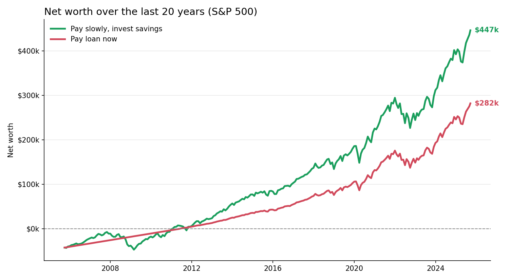

# Student Loan vs. Investing

Should you use your savings to pay off a student loan right away, or pay it off slowly and keep that money invested in the S&P 500?

This project simulates both choices over the last 20 years of real S&P 500 data.



## The two strategies

| Script | Strategy |
| --- | --- |
| [Pay_Loan_Now.py](Pay_Loan_Now.py) | Put the $75k of savings toward the loan right away. Once the loan is paid off, invest the monthly payment. |
| [Pay_Loan_Slowly.py](Pay_Loan_Slowly.py) | Keep the $75k invested in the S&P 500 and pay the loan monthly. Once the loan is paid off, invest the monthly payment. |

Default inputs (set at the top of each script):

```python
student_loan = -117687         # loan balance
savings_account = 75000        # starting savings
monthly_loan_payment = 622     # monthly payment
worst_return = 20              # years to simulate
```

## Run it

```bash
pip install pandas matplotlib
python Pay_Loan_Slowly.py   # shows net worth, loan balance and savings charts
python Pay_Loan_Now.py      # saves savings_square.png
```

## Data

[spy.csv](spy.csv) holds monthly S&P 500 values from 1935 to 2025 (`Date,Value`).

## Limitations

- Loan interest isn't modeled, so the loan balance only goes down by the monthly payment.
- Taxes and fees aren't included.
- Past market returns don't guarantee future results. This is not financial advice.
